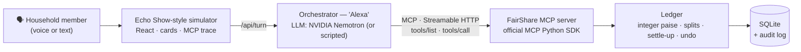

# FairShare

**Shared household expenses, settled by voice.** A self-hosted MCP server for Alexa+, shown on a
simulated Echo Show.

> *"Alexa, I paid ₹2,400 for groceries. Split it with Priya and Neha, but Neha was away half the week."*
> — *"₹2,400, paid by Rahul, split as Rahul ₹960, Priya ₹960 and Neha ₹480. Shall I save it?"*

Built for **Build, Ship, Shape: Amazon Developer Hackathon 2026 — Alexa+ track**.

[](LICENSE)
· MCP spec **2025-11-25** · Streamable HTTP · official MCP Python SDK

---

## The problem

Every shared home — roommates, couples, families — has the same running question: *who paid for
what, and who owes whom?* Groceries, rent, electricity, takeaway. The record lives in a
spreadsheet nobody updates or an app nobody opens, because the moment you pay is the moment your
hands are full: unpacking shopping in the kitchen, right next to an Echo Show.

FairShare lets the household keep its shared money straight by **talking to Alexa**, and see it on
the screen.

## What it does

- **Understands messy, real-life splits.** "Neha was away half the week", "only I had the wine",
  "just me and Neha" — turned into exact shares and read back before saving.
- **Every way households split:** equal, weighted shares, percentages, exact amounts, and items that
  belong to only some people.
- **Several people, one household.** Anyone can ask *"Who owes what?"*, say *"I paid Rahul back
  ₹500"*, or *"Undo that."*
- **Settle up in few payments.** *"Settle up"* turns a month of expenses into a short list of who
  pays whom.
- **Voice-first, with a screen.** Balance bars, the split awaiting confirmation, settle-up arrows,
  recent activity and a monthly summary appear as cards on the Echo Show-style display.
- **Knows who's speaking** (simulated Alexa+ voice ID), or you just say *"This is Priya…"*. If it
  doesn't know, it asks before changing anything.
- **Asks instead of guessing.** *"Split the pizza"* → *"How much was it, and who shared it?"*
- **Never moves money.** It suggests payments; you record them when they happen.

## Why it's an Alexa+ experience

| | |
|---|---|
| **Consumer, everyday use** | A weekly household chore, done hands-free in the kitchen. |
| **New to Alexa+** | Alexa+ has lists, reminders and shopping; a multi-person ledger with balances and settle-up is new. |
| **Only possible with today's AI** | Understanding *"Neha was away half the week"* or *"leave out the wine"* and asking a clarifying question needs an LLM — and keeping balances exact across weeks needs more than an LLM. |
| **Multimodal** | Short spoken replies; the details on screen. |
| **Stateful, multi-step, multi-person** | Preview → confirm → save, undo, payments and settle-up across sessions and speakers. |

## How it works

**The LLM understands; the MCP server calculates.**



1. **FairShare MCP server — the product.** Ten tools over Streamable HTTP (spec 2025-11-25). It owns
   all the money logic and data. It contains no LLM.
2. **Orchestrator — stands in for Alexa+.** A real MCP client: it offers the server's tools to an LLM,
   runs the tool calls the LLM chooses, and returns speech, screen cards and a trace.
3. **Simulator — stands in for an Echo Show.** Mic or text input, spoken replies, cards from the
   tools' `display` hints, a simulated voice-ID selector, and a live MCP trace panel. Like an Echo's
   **Follow-Up Mode**, after a reply it keeps listening for about 5 seconds, so a conversation
   doesn't need the mic button each time; pauses of up to 3 seconds don't cut you off mid-sentence.

> **Why a simulator?** The Alexa+ Add-on toolkit and web simulator are in preview with select
> partners and aren't available to hackathon participants, so the device is simulated. The MCP
> server is exactly what an Alexa+ integration would call.

### Design choices that keep the money right

- **Exact by construction.** Every amount is integer paise. Uneven splits use a documented
  largest-remainder rule, so shares always add up to the bill and balances always sum to zero.
- **The LLM never does arithmetic.** It describes the split the way the speaker did (e.g. weights
  `{Rahul: 1, Priya: 1, Neha: 0.5}`); the server works out the rupees.
- **Alexa speaks the server's sentence.** After a successful tool call, the spoken reply is the
  tool's own `speech`, written from exact ledger numbers. In testing, an LLM paraphrase once attached
  the right amounts to the wrong people — so it no longer gets the chance.
- **Preview, then confirm.** `preview_split` calculates without saving, so a mistake is heard before
  it's recorded.
- **Safe undo.** Every change is in an audit log with who made it. Undo reverts only *your* last
  action, and refuses if someone has changed that entry since.
- **Idempotent writes.** A retried request with the same `request_id` never saves twice.

## The MCP server

| | |
|---|---|
| Endpoint | `http://127.0.0.1:8010/mcp` (Streamable HTTP) · health: `/health` |
| Protocol | MCP **2025-11-25** (initialize handshake) and 2026-07-28 — both verified by tests |
| SDK | official [MCP Python SDK](https://github.com/modelcontextprotocol/python-sdk) `mcp==2.3.0` |
| Household | predefined members (Rahul, Priya, Neha), as Alexa+ household profiles would provide |

| Tool | What it does |
|---|---|
| `list_household_members` | The household's members |
| `preview_split` | Work out a split **without saving**, to read back for confirmation |
| `add_expense` | Save a shared expense (equal, weights, percent, exact, plus items for specific people) |
| `edit_expense` | Change an expense |
| `undo_last` | Undo the speaker's own last action |
| `record_payment` | Record that one member paid another back |
| `get_balances` | Who owes what |
| `settle_up_plan` | Suggested payments to settle everyone up (never moves money) |
| `list_expenses` | Recent expenses and payments, with ids |
| `monthly_summary` | A month's spending by category and member |

Every tool returns a short spoken reply as text content, plus structured content with an output
schema:

```json
{
  "speech": "₹2,400, paid by Rahul, split as Rahul ₹960, Priya ₹960 and Neha ₹480. Shall I save it?",
  "data":   { "payer": "Rahul", "amount": { "paise": 240000, "text": "₹2,400" }, "shares": [ … ] },
  "display": { "card": "confirm_split", "data": { … } }
}
```

**Use it from any MCP host**, e.g. Claude Code:
`claude mcp add --transport http fairshare http://127.0.0.1:8010/mcp`

## Quick start

**Prerequisites:** [uv](https://docs.astral.sh/uv/) (installs Python 3.12+ automatically) and
[Node.js](https://nodejs.org/) 20.19+ or 22.12+ with npm.

```bash
git clone https://github.com/arpan21020/FairShare.git
cd FairShare
python run.py          # macOS/Linux may need: python3 run.py
```

`run.py` works on Windows, macOS and Linux. It installs dependencies, builds the screen if it
changed, starts the MCP server and then the orchestrator, and opens **http://127.0.0.1:8001** in a
new browser window (Chrome or Edge preferred — the microphone needs them). **Ctrl+C** stops
everything.

| Option | Effect |
|---|---|
| `--seed` | add a few weeks of **seeded, fictional** sample expenses |
| `--reset` | wipe the ledger first (members only, zero balances); with `--seed`, fresh samples |
| `--no-browser` | don't open a browser |
| `--build` | force a rebuild of the screen |
| `--mcp-port`, `--port` | change the ports (defaults 8010 and 8001) |

### Live mode (LLM) vs scripted mode

- **Scripted** — no key needed. Replays the demo conversation through the same MCP tools; click the
  suggestions under the device.
- **Live** — an LLM plays Alexa. Copy `.env.example` to `.env` and set `NVIDIA_API_KEY` (free at
  [build.nvidia.com](https://build.nvidia.com/)). The default model is
  `nvidia/nemotron-3.5-lightning-30b-a3b` with thinking on. Any OpenAI-compatible endpoint works via
  `LLM_BASE_URL`, `LLM_API_KEY` and `LLM_MODEL`.

### Manual start (what run.py does)

```bash
cd backend
uv run python -m houseledger.mcp_server            # terminal 1 (add --seed for sample expenses)
uv run python -m orchestrator.app                  # terminal 2
cd ../simulator && npm install && npm run build    # once; or `npm run dev` → http://localhost:5173
```

## Tests

```bash
cd backend
uv run pytest -q        # 104 tests
```

They cover every split type and rounding edge case, randomized runs checking that balances always
net to zero, undo and idempotency, the MCP tools in-process **and over Streamable HTTP on both
protocol versions**, the full scripted demo against a real server, the live LLM tool loop (with a
stand-in LLM), and speaker detection. The frontend is type-checked and linted on build.

## Project structure

```text
run.py                      one-command start (Windows, macOS, Linux)
backend/
  houseledger/              the FairShare MCP server (the product)
    mcp_server.py           tools, Streamable HTTP entry point
    ledger.py · splits.py   money logic: expenses, splits, balances, settle-up, undo
    presenters.py           speech + data + screen cards for each tool
    db.py · seed.py         SQLite schema; predefined household and sample data
  orchestrator/             simulated Alexa+ host
    llm_loop.py             live mode: LLM + MCP client tool loop
    scripted.py             scripted demo mode (no LLM)
    speakers.py             "This is Priya…" speaker detection
    app.py                  HTTP API for the simulator
  tests/
simulator/                  Echo Show-style screen (React + TypeScript + Vite)
docs/friction-log.md        product feedback from building this
```

## Limitations

- The Alexa+ device is **simulated**; real Alexa+ integration isn't available to participants.
- Voice ID is simulated by a selector (or by saying who you are).
- Household members are predefined; one household per database.
- Indian rupees only. Settle-up uses a greedy plan: at most *members − 1* payments, usually the
  fewest, not guaranteed minimal.
- Free-tier LLM latency varies (typically 2–6 s per turn).
- All sample data is **seeded and fictional**.

## What's next

Real Alexa+ integration and voice ID when the toolkit opens · recurring bills · receipt photos on
the Echo Show camera · UPI payment links for settle-up (still never holding money) · trips and
multiple currencies · a monthly "time to settle up" nudge.

## Product feedback

Our friction log from building this — what slowed us down and what would help developers building
for Alexa+ — is in [docs/friction-log.md](docs/friction-log.md).

## License

[MIT](LICENSE)
